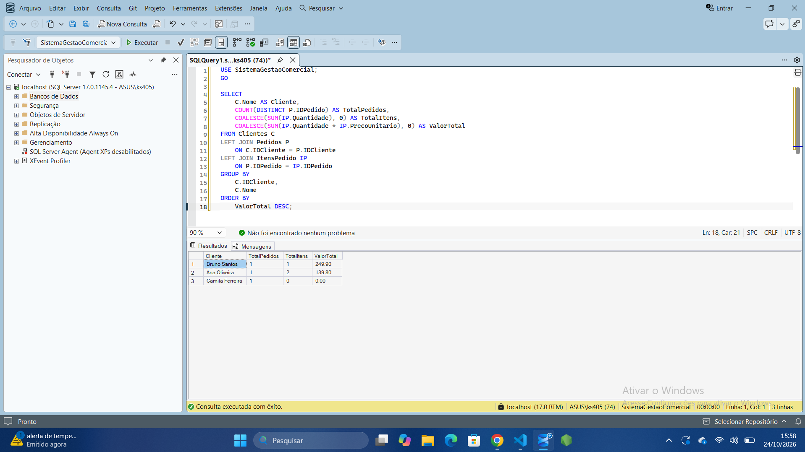
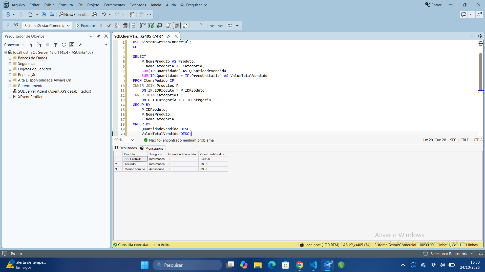
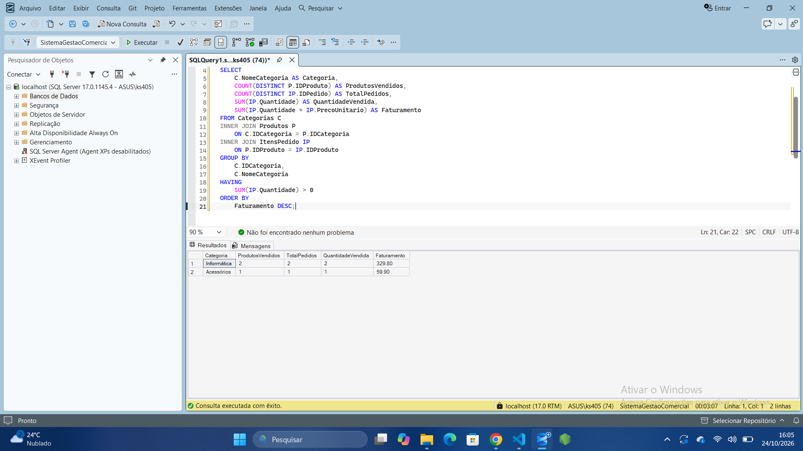
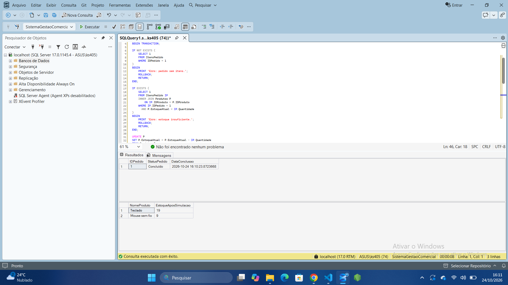
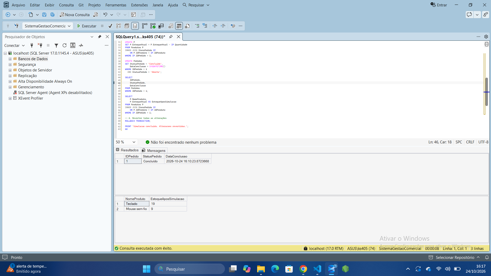

# Sistema de Gestão Comercial

Projeto desenvolvido utilizando **Microsoft SQL Server e T-SQL**, com o objetivo de aplicar conceitos de bancos de dados relacionais em um cenário de gestão comercial.

## Objetivo

Desenvolver um banco de dados para gerenciar clientes, categorias, produtos, pedidos e itens de pedidos, aplicando relacionamentos, restrições de integridade e consultas SQL.

## Tecnologias utilizadas

- Microsoft SQL Server
- SQL Server Management Studio (SSMS)
- T-SQL

## Estrutura do banco de dados

O banco de dados `SistemaGestaoComercial` possui cinco tabelas:

- **Clientes:** cadastro de clientes.
- **Categorias:** classificação dos produtos.
- **Produtos:** informações, preços e controle de estoque.
- **Pedidos:** registro e acompanhamento de pedidos.
- **ItensPedido:** produtos e quantidades associados aos pedidos.

## Funcionalidades e conceitos aplicados

- Criação e estruturação de bancos de dados relacionais.
- Chaves primárias e estrangeiras.
- Restrições `PRIMARY KEY`, `FOREIGN KEY`, `UNIQUE`, `CHECK` e `DEFAULT`.
- Relacionamentos entre tabelas.
- Consultas com `INNER JOIN` e `LEFT JOIN`.
- Funções de agregação: `SUM`, `COUNT`, `AVG`, `MIN` e `MAX`.
- Agrupamentos com `GROUP BY` e `HAVING`.
- Subconsultas com `IN`, `NOT IN`, `EXISTS` e `NOT EXISTS`.
- Transações com `BEGIN TRANSACTION` e `ROLLBACK`.
- Validação de regras de negócio por meio de scripts SQL.

## Demonstração do Projeto

### 1. Relatório geral por cliente

### 2. Produtos mais vendidos

### 3. Desempenho de vendas por categoria

### 4. Validação de estoque e transação

### 5. Resultado da transação e rollback

## Testes realizados

Foram desenvolvidos testes para simular:

1. Conclusão de pedidos com estoque suficiente.
2. Impedimento da conclusão de pedidos vazios.
3. Identificação de estoque insuficiente.
4. Cancelamento de pedidos e devolução de estoque.
5. Prevenção de devolução duplicada de estoque.

**Observação:** as regras de negócio foram testadas por meio de scripts transacionais. Ainda não foram implementadas como mecanismos automáticos no banco, como procedures ou triggers.

## Objetivo de aprendizagem

Consolidar conhecimentos em SQL Server e T-SQL por meio de um projeto prático, simulando operações comuns de um sistema de gestão comercial.